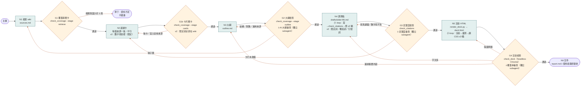

# Workflow：主題 → 教學 HTML 簡報（Graph 版，v2）

> 目前版本：**v2**（run-002 使用）。v1（run-001 使用）與修改理由見 §8「v1 → v2 修改紀錄」。

> 參考課程第 41–47 頁（Loop 版、Graph 版、每關只能看什麼、退回路線、狀態都是檔案）與第 21–26 頁（loop 五件事、剎車、大圈小圈）。
> 呼叫方式：skill `/topic-slides <主題>`（`.claude/skills/topic-slides/SKILL.md`）。每次執行的狀態都存在 `runs/run-NNN/`。

## 1. 流程圖

橘色線＝退回路線。橘框＝檢查關卡（腳本＋獨立 AI 審查），藍框＝AI 生成節點。

## 2. 每個節點的規格

| 節點 | 輸入檔 | 輸出檔 | 只能看 | 不能做 | 檢查方式 | 失敗退回 |
|---|---|---|---|---|---|---|
| **N1 檢索 wiki** | 主題、`wiki/index.md` | `sources.md`（相關頁面＋來源清單＋選頁理由） | `wiki/index.md`、wiki 頁面 | 讀 `raw/`、用模型自己的知識 | G1 | — |
| **G1 覆蓋率關卡** | `sources.md` | 終端輸出→`report.md` | `sources.md`、被列頁面的 frontmatter | 自己改 sources.md | `check_coverage.py --stage retrieve`：頁面存在、**≥3 頁**、來源清單＝頁面實際引用的來源 | < 3 頁 → **STOP**；其他 → N1 |
| **N2 證據卡**（平行，每來源一張） | `sources.md` 中與該來源有關的 wiki 頁 | `cards/<key>.md`（`- E1: 主張 [wiki: 頁] [src: key, p.N]`） | **一個來源**相關的 wiki 頁面 | 混入其他來源、引用未檢索的頁面 | G1b | — |
| **G1b 卡片關卡** | `cards/`、`sources.md` | → `report.md` | 卡片、sources.md | 自己改卡片 | `check_coverage.py --stage cards`：每個來源都有卡、每項標 wiki 頁、只引用自己的來源 | 缺卡／混來源 → N2（只重做那張卡） |
| **N3 大綱** | `cards/`、教學結構（SKILL.md） | `outline.md`（每頁：標題、教學目標、evidence、wiki） | 證據卡 | 引用卡片沒有的內容 | G2 | — |
| **G2 大綱檢查** | `outline.md`、`cards/` | → `report.md`、`reviews/outline-roundN.md` | 大綱＋卡片 | 自己動手改大綱 | ① `check_coverage.py --stage outline`：8–15 頁、證據編號存在、**每個來源至少被一頁用到** ② 獨立 subagent 審查教學結構 | 結構問題 → N3；缺子題 → N1 補檢索 |
| **N4 逐頁稿** | `outline.md` 的一頁＋**該頁對應的卡片** | `drafts/slide-NN.md` | 該頁大綱＋對應卡片（＋卡片指到的 wiki 頁） | 引用卡片以外的內容、編數字 | 節點內小 loop：寫→`check_citations.py --slides N`→修，**≤2 輪** | — |
| **G3 忠實度檢查** | `drafts/`＋被引用的 wiki 頁 | → `report.md`、`reviews/faithfulness-roundN.md` | 逐頁稿＋被引用 wiki 頁（**不給生成過程**） | 自己動手改稿 | ① `check_citations.py`：每頁有出處、頁面存在且在檢索結果內、**數字都能在被引用頁找到** ② 獨立 subagent 逐頁判定忠實度 | 某頁有錯 → **只退那幾頁**回 N4；卡片本身錯 → N2 重抽那張卡 |
| **N5 渲染 HTML** | 已通過 G3 的 `drafts/` | `deck.html` | 逐頁稿、`scripts/deck_template.html` | **改任何一個字**（只能改 CSS） | 節點內小 loop：`render_deck.py`→`check_deck.py`→調 CSS，**≤3 輪** | — |
| **G4 渲染檢查** | `deck.html`、`drafts/` | → `report.md`、`screenshots/`、`reviews/coverage-roundN.md` | 成品＋被引用 wiki 頁 | 自己動手改 | ① `check_deck.py`：8–15 頁、頁尾出處與頁碼、**渲染文字＝逐頁稿**、headless Chrome 量測**無溢出**、**鍵盤翻頁真的會動** ② 獨立 subagent 審查覆蓋率 | 版面 → N5；字太多 → N4 縮短；漏重要內容 → N3 |
| **N6 交件** | 全部 | `report.md` 總結 | — | — | 使用者最終驗收 | — |

### 兩個實作上的決定
- **渲染用腳本、不用 AI**：`render_deck.py` 只做 markdown→HTML 的機械轉換，所以「渲染節點不能改字」由構造保證；`check_deck.py` 再逐頁比對渲染文字與逐頁稿，雙重確認。
- **數字一律保留原文寫法**（`$314 million` 不換成「3.14 億」）：階段 3 的 lint 發現換算後的數字無法機械驗證（見 `docs/lint-history.md`），所以 `check_citations.py` 要求簡報數字在被引用的 wiki 頁「原樣」出現。

## 3. 哪些步驟會重複執行？

| 類型 | 位置 | 上限 | 說明 |
|---|---|---|---|
| 節點內小 loop | N4 逐頁稿 | 2 輪 | 寫一頁 → `check_citations --slides N` → 只修報告列出的問題（課程 p.46） |
| 節點內小 loop | N5 渲染 | 3 輪 | 渲染 → headless Chrome 量測／截圖 → 改 CSS → 再量測（課程 p.46） |
| 關卡退回（小圈） | G1b→N2、G2→N3、G3→N4、G4→N5 | 每個關卡 3 輪 | 錯在哪一關就退回哪一關，**只修出錯的那頁／那張卡** |
| 關卡退回（大圈） | G2→N1、G4→N3、G3→N2 | 同上 | 跨過多個節點的退回，應該很少發生 |
| 平行 | N2 證據卡 | — | 每個來源一張卡，互不相看 |

## 4. 停止條件（剎車，課程 p.23）
1. **資料不足就停**：G1 相關頁面 < 3 → 整個 run 停下，不用模型知識硬湊。
2. **每個關卡最多 3 輪**；N4 小 loop 最多 2 輪、N5 小 loop 最多 3 輪。改滿仍不過 → 在 `report.md` 記錄未通過項目，以目前最佳版本往下走，並在交件時明講。
3. **全部關卡通過** → 交件。
4. 每一輪只修檢查報告列出的問題，不順手改別的（避免越改越多）。

## 5. 為什麼這樣設計

**(1) 用 graph 而不是單一 loop。** 課程 p.27：「loop 每次都整份重來、各階段標準不同」時就該拆成 graph。這個任務的各階段標準完全不同：檢索看「夠不夠」，證據卡看「有沒有混來源」，逐頁稿看「忠不忠實」，渲染看「有沒有溢出」。用單一 loop 的話，一個溢出問題也要整份重跑。

**(2) 大圈很少轉、小圈轉得快（課程 p.26）。** 每個關卡緊跟在產生錯誤的節點之後，錯誤在離源頭最近的地方被抓到：
- 數字編錯 → 在 G3 就抓到，只退那一頁回 N4（小圈），不會等到最後看簡報才發現。
- 版面溢出 → 在 N5 自己的小 loop 修 CSS；真的是字太多才退回 N4。
- 漏用來源 → 在 G2 大綱階段就由 `check_coverage --stage outline` 抓到（課程 p.40「8 篇只用了 3 篇」），不必等到簡報做完。
- 大圈（G4 → N3、G2 → N1）保留為安全網。**如果實際執行常常轉大圈，就代表檢查該往前移**——這是 v2 要依據 run-001 的數據調整的地方。

**(3) 每一關只能看什麼（課程 p.44）。** 證據卡一次只看一個來源，避免把 A 論文的數字安到 B 論文上；逐頁稿只能看對應的卡片，避免「順手」補上 wiki 沒有的知識；渲染不能改字，避免排版時偷改句子；審查者只看成品與來源，不看生成過程，避免被生成者的說法帶著走（課程 p.22）。

**(4) 程式檢查與 AI 審查分工（課程 p.22）。** 能用程式判斷的（頁面存在、數字找得到、頁數、溢出、翻頁）全交給腳本，以 exit code 判定；只有程式做不到的（意思有沒有講反、教學順序好不好、有沒有漏掉重點）才交給獨立的 subagent。

## 6. 誠實的取捨：沒有「人工確認大綱」
課程 p.43 的 graph 在大綱之後有「人工確認」節點。這次因為截止時間緊，改成 **G2 的 AI 大綱審查（獨立 subagent）＋使用者在交件前的最終驗收**。代價是：如果大綱的教學方向本身不符合使用者期待，要到最後才會發現，屆時要退回 N3（大圈）。若時間允許，應該恢復人工確認大綱這一關。

## 7. 溢出檢查的實作與限制
- 優先用 **headless Chrome**（本機 Chrome 158）以 1280×720 實際排版，量測每頁 `.content` 的 `scrollHeight`／`scrollWidth`，並檢查每個子元素有沒有超出內容框；同時截圖存到 `screenshots/`。
- 找不到 Chrome/Edge 時，`check_deck.py` 自動改用字數（≤260）與行數（≤12）上限近似，並在輸出註明。本次執行有 Chrome，**沒有用到**近似法。
- 已知限制：只量測 1280×720 這一種尺寸；手機直式畫面靠整頁等比縮放，沒有另外量測。

## 8. v1 → v2 修改紀錄

### run-001 的數據（`python scripts/report_stats.py runs/run-001`）
| 節點 | 失敗次數 | 內容 |
|---|---|---|
| **G3 忠實度** | **3 輪都 FAIL**（4 頁 → 1 頁 → 1 頁），第 3 輪觸發剎車 | 拿掉限定詞（「Naive RAG」「作者認為」「兩個資料集」）、加概括詞（「常」）、未標記比喻（「課本」）、自己的歸類（「兩個地方」）、用了卡片以外的內容 |
| N5 渲染（小 loop） | 2 | 溢出 12px／28px／2px，CSS 調 3 輪解決 |
| G2 大綱 | 1 | 一頁塞三個新概念 |
| G4 覆蓋率 | 0（PASS） | 但順便發現一個 G3 三輪都漏掉的忠實度問題（表格「＋」暗示疊加） |

**診斷**：G3 最常出錯，但錯誤都**產生在 N4 逐頁稿**（為零基礎讀者簡化時把條件與限定詞丟掉）。v1 的 `check_citations` 只檢查「數字與出處存在」，這類錯誤全部要等 G3 的 AI 審查才抓到；每修一輪都要開新的審查者，第 3 輪還是沒過——典型的「小圈轉不停」，而且有一次變成大圈（G3 → N2 補卡）。課程 p.26：常常在後段轉圈，代表檢查該往前移。

### 改了什麼
| # | 改動 | 位置 | 往前移到哪 | 為什麼 |
|---|---|---|---|---|
| 1 | 證據卡的數字項目必須標 `〔限定：…〕`（實驗條件、範圍、歸屬，例如「Naive RAG」「作者認為」「Podcast／新聞」），且**限定詞必須原樣出現在 wiki** | `check_coverage.py --stage cards --rules v2`、SKILL.md 卡片格式 | **G3 → N2/G1b**（源頭） | run-001 有 3 個錯是「限定詞在寫稿時被丟掉」；把限定詞變成卡片上的必填欄位，下游才有東西可以機械比對 |
| 2 | 限定詞保留檢查：逐頁稿用到某個證據，就必須寫出它的限定詞 | `check_citations.py --rules v2`（N4 小 loop） | **G3 → N4** | 讓「丟掉條件」在寫完那一頁就被腳本抓到，不必等 AI 審查 |
| 3 | 概括詞檢查：「常、通常、總是、一定、保證、永遠…」出現在稿中但不在被引用 wiki → FAIL | 同上 | **G3 → N4** | run-001 slide 6「常」、slide 10「保證」 |
| 4 | 引號詞檢查：稿中「」裡的詞必須出現在被引用 wiki（比喻框除外） | 同上 | **G3 → N4** | run-001 slide 7「課本」是未標記比喻 |
| 5 | 忠實度審查者指示加一條：表格與符號（＋、→、比較方向）也要檢查 | `reviewers/faithfulness.md` | G3 本身 | run-001 的「＋」漏網，是 G4 才順便發現 |

graph 的節點與退回路線不變；改的是**檢查的位置**——把 G3 裡「可以機械化」的部分拆出來，放到 N2（源頭）和 N4（寫稿當下的小 loop）。G3 的 AI 審查保留，只處理腳本抓不到的意思偏移（例如「自己的歸類」）。

### 往前移的檢查真的有用嗎？（回測）
把 v2 的 `check_citations` 拿去跑 **run-001 第一版逐頁稿**（G3 之前的版本），結果存在 `runs/run-001/checks/retro-v2-checks-on-round1-drafts.txt`：
- 抓到 G3 round 1 失敗 4 頁中的 **3 頁**（slide 6「常把」、slide 7「課本」、slide 10「保證」）。
- 沒抓到 slide 9（丟掉「兩個資料集」條件）——因為 v1 的卡片沒有〔限定〕欄位；v2 改動 #1 就是為了補這個洞。
- 誤報 3 個：slide 14 小測驗的問句「一定要重新訓練嗎？」、slide 9／12 我自己加引號的短語。誤報的處理方式是改寫（不加引號、問句換說法），成本很低。
- 仍抓不到的：「自己的歸類」（slide 10 round 3）、「用了卡片以外的內容」——這兩種只能留給 G3 的 AI 審查。

### 沒有改的
- N5 渲染溢出：雖然失敗 2 次，但都在 N5 自己的小 loop 內 3 輪解決，沒有退回上游；字數也預測不了溢出（slide 11 有 286 字沒溢出、slide 8 有 294 字溢出），所以不往前移，維持現狀。
- 人工確認大綱：仍以 AI 大綱審查替代（見 §6）。
